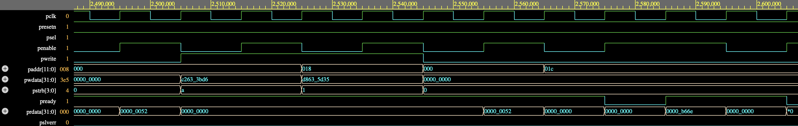
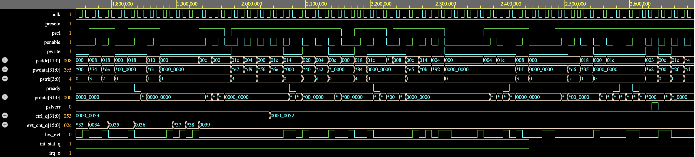

# Constrained-Random Verification of an AMBA APB4 Register Bank

Block-level verification of an AMBA APB4 peripheral register bank using a
layered, class-based SystemVerilog testbench: constrained-random stimulus, a
cycle-accurate reference-model scoreboard, functional coverage, and SVA
protocol checks. Runs on the free Verilator simulator and on Questa / VCS /
Xcelium.

**Result:** 50/50 regression runs passing (5 tests × 10 seeds), ~27,000
transfers and ~133,000 individual checks, **100% functional coverage**
(31/31 bins), and both seeded RTL bugs detected.
Also verified on **Synopsys VCS** (EDA Playground): `rand_test` passes with
2,002 transfers, 0 mismatches, and 100% coverage from both the bin table and the
SystemVerilog covergroup `cg_regbank`.

---

## Design under test

`rtl/apb_regbank.sv` — a typical peripheral control block:

| Offset | Register | Access | Notes |
|--------|----------|--------|-------|
| 0x000 | CTRL     | RW  | `[0]` enable, `[1]` irq_en, `[7:4]` cfg; other bits reserved |
| 0x004 | STATUS   | RO  | 16-bit count of `hw_evt` pulses while enabled |
| 0x008 | INT_STAT | W1C | sticky event flag; event wins over a simultaneous clear |
| 0x00C | SCRATCH  | RW  | |
| 0x010–0x01C | DATA0–3 | RW | reads insert **one wait state** |
| 0x020 | ID       | RO  | `0x5A0B_0101` |

PSTRB byte enables, PSLVERR on unmapped or misaligned addresses, and
`irq_o = INT_STAT & irq_en`.

## Testbench architecture

```
                 ┌──────────────────────────── tb_top ───────────────────────────┐
  tests.sv       │                                                               │
 ┌───────────┐   │  ┌─────────┐ req_mb ┌────────────┐  apb_req_if  ┌───────────┐ │
 │ reset     │──────▶ apb_txn │───────▶│ apb_driver │─────────────▶│           │ │
 │ strb      │   │  │ (rand)  │        └────────────┘              │apb_regbank│ │
 │ irq_w1c   │   │  └─────────┘        ┌────────────┐   hw_evt     │   (DUT)   │ │
 │ err       │──────────────────────── │ evt_driver │─────────────▶│           │ │
 │ rand      │   │                     └────────────┘              └─────┬─────┘ │
 └───────────┘   │                                       apb_cpl_if      │       │
                 │  ┌────────────┐ one obs  ┌─────────────┐◀──────────────┘       │
                 │  │ scoreboard │◀─────────│ apb_monitor │  apb_protocol_checker │
                 │  │ + ref model│ per cycle└─────────────┘  (5 concurrent SVA)   │
                 │  └─────┬──────┘                                               │
                 │        ▼ coverage_model (covergroup + portable bin table)     │
                 └───────────────────────────────────────────────────────────────┘
```

| File | Role |
|------|------|
| `tb/apb_txn.sv` | Transaction; traffic shape knobs (`illegal_pct`, `write_pct`, `data_only`) |
| `tb/apb_driver.sv` | APB4 requester FSM, supports back-to-back transfers |
| `tb/evt_driver.sv` | Random or directed `hw_evt` pulses |
| `tb/apb_monitor.sv` | Passive; emits one observation **per clock edge** |
| `tb/regbank_model.sv` | Table-driven reference model written from the spec |
| `tb/scoreboard.sv` | Replays each edge in RTL order; checks PRDATA, PSLVERR, irq_o |
| `tb/coverage_model.sv` | 31-bin coverage plan; covergroup on commercial tools |
| `tb/apb_protocol_checker.sv` | APB4 handshake SVA, bindable to any APB port |
| `tb/tests.sv` | Five tests (directed + random) |
| `docs/verification_plan.md` | Feature → stimulus → checker → coverage traceability |

### Assertions (three levels)

* **Protocol (SVA):** SETUP→ACCESS, PENABLE needs PSEL, request stable while
  stalled, PSTRB=0 on reads, PSLVERR only in the completing cycle.
* **Designer (SVA in RTL):** an enabled event always sets INT_STAT; PSLVERR
  is never raised for a mapped address.
* **Directed (immediate):** ID value, SCRATCH readback, RO-write ignored,
  reserved bits zero, misaligned writes do not alias, counter value, IRQ.

## Running it

Requires Verilator ≥ 5.028 (for constrained randomization) and `z3`.

```bash
cd sim
make TEST=rand_test SEED=7            # one test
make TEST=irq_w1c_test                # any of the five tests
./regress.sh 10                       # 5 tests x 10 seeds + merged coverage
./regress.sh 1 BUG_STRB               # rebuild DUT with a seeded bug
make questa TEST=rand_test            # commercial flow, covergroups enabled
```

### Running on EDA Playground (no install needed)

`edaplayground/` has two-file versions of the project with no `` `include``s.
Run `python3 edaplayground/make_edap.py` to regenerate them after changing the sources.

| Simulator | Folder to use | SVA |
|-----------|---------------|-----|
| Aldec Riviera-PRO (free tier) | `edaplayground/riviera/` | removed (the free licence won't simulate modules that contain SVA) |
| Synopsys VCS / Cadence Xcelium / Siemens Questa | `edaplayground/vcs/` | all checks on |

Paste `design.sv` and `testbench.sv` from that folder into the matching tabs,
replacing everything in each tab. Then set *Run Options* to `+TEST=rand_test`
(or another test name). Add `+DUMP` and tick *Open EPWave after run* to see
waveforms. The Riviera build still runs the scoreboard, coverage
and immediate assertions.

A run passes only if the scoreboard reports zero mismatches **and** the log
contains no simulator errors, so an SVA failure cannot slip through.

## Results

```
runs passed: 50   runs failed: 0
merged functional coverage: 31 / 31 bins (100.0%)
```

Synopsys VCS, `+TEST=rand_test` (single seed):

```
[COV] functional coverage (bin table): 100.0%
[COV] covergroup cg_regbank          : 100.0%
[SB] transfers checked : 2002
[SB] individual checks : 9763
[SB] mismatches        : 0
[TB] *** TEST PASSED : rand_test ***
```

### Waveforms (Synopsys VCS, EPWave)


*Back-to-back APB transfers on VCS: a byte-strobed write to CTRL's reserved bytes
leaves it unchanged (0x52 read back), a single-byte write, and a one-cycle wait
state on a DATA register read (PREADY low).*


*hw_evt pulses increment the event counter while CTRL.enable = 1. After CTRL is
written to 0x52 (enable off), events are ignored while the sticky INT_STAT flag
holds irq_o high. A write of 1 to INT_STAT (0x008) clears the flag and drops irq_o.*

Testbench validation — the TB is only useful if it fails on broken RTL:

| Seeded bug | Caught by | Log excerpt |
|------------|-----------|-------------|
| `BUG_STRB` DATA regs ignore PSTRB | scoreboard | `RD addr=0x010 data=0xa5a5a5a5 ... expected 0x000000a5` |
| `BUG_W1C` writing 0 clears INT_STAT | scoreboard | `cycle 40: irq_o=0 expected 1` |
| Driver changes PADDR while stalled | SVA | `a_stable_in_wait: APB: request changed while PREADY was low` |

## Engineering notes (things that went wrong and were fixed)

1. **Cycle-ordering in the scoreboard.** An event and a W1C clear (or a CTRL
   write) can land on the same edge. A transaction-level scoreboard cannot
   tell which came first, so the monitor sends one record per cycle and the
   scoreboard replays it in the RTL's evaluation order. See the header of
   `scoreboard.sv`.
2. **Measured the stimulus, found it was wrong.** The first version used
   `dist` constraints. Measuring 2,000 transactions showed ~75% error traffic
   instead of 5%: the Verilator SMT solver ignores `dist` and returns
   low-biased solutions. Traffic weights moved to `pre_randomize()`, and the
   warning suppression that hid this was removed from the Makefile. After the
   fix: 5.0% illegal, 50% writes, 61% full-word strobes — on target.
3. **Simulator scheduling bug.** A single interface carrying both TB-driven
   inputs and DUT combinational outputs hung Verilator 5.036 ("input
   combinational region did not converge"). Reduced to a 10-line repro,
   then worked around by splitting into requester/completer interfaces and
   moving the SVA into a standalone, bindable checker module.

## Limitations / next steps

UVM port with a RAL model; mid-traffic reset; UCDB-level coverage merge;
formal proof of the protocol properties.
